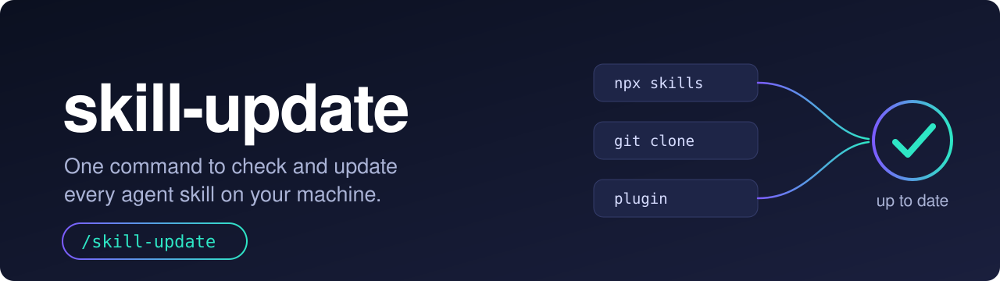
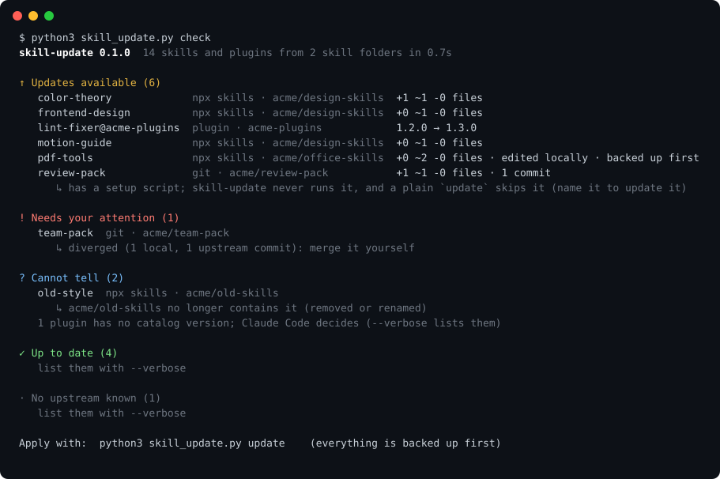
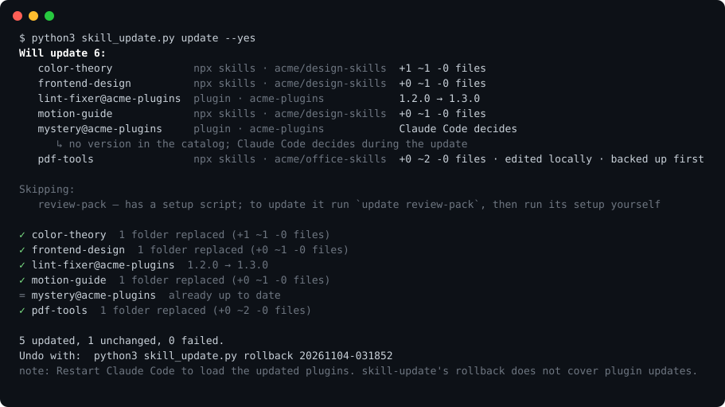

<p align="center">
  
</p>

# skill-update

어떻게 설치했든, 컴퓨터에 깔린 모든 에이전트 스킬을 명령 하나로 점검하고 업데이트합니다.

[](https://github.com/kjhk3082/skill-update/actions/workflows/ci.yml) · [English](README.md)

```bash
npx skills add kjhk3082/skill-update -g
```

에이전트를 다시 시작하고 `/skill-update`를 실행하세요. "내 스킬 최신이야?"라고 물어도 됩니다.

Claude Code, Codex, Cursor, Gemini CLI, OpenCode, GitHub Copilot, Windsurf, Kiro처럼 폴더에서 스킬을 읽는 모든 에이전트에서 동작합니다(알려진 스킬 폴더만 60곳이 넘습니다). 플러그인 갱신은 Claude Code가 있어야 합니다.

| skill-update 없이 | skill-update와 함께 |
|---|---|
| `npx skills check`는 `npx skills`로 깐 것만 압니다.<br>git 복제본은 폴더마다 들어가서 `git pull`.<br>플러그인은 하나씩 업데이트.<br>손으로 복사한 스킬은 오래됐는지 알 방법이 없습니다. | `/skill-update`<br>모든 스킬 폴더를 한 번에 훑고, 보고서 한 장, 확인 한 번.<br>바뀌는 폴더는 먼저 백업합니다. |

<p align="center">
  
</p>

만든 사람의 컴퓨터에서 처음 돌렸을 때 스킬과 플러그인 216개 중 32개가 뒤처져 있었고, 원본 저장소가 더는 배포하지 않는 스킬이 6개 있었습니다.

## 왜 필요한가

스킬이 컴퓨터에 들어오는 길은 네 가지입니다: `npx skills add`, `git clone`, Claude Code 플러그인, 그냥 복사. 길마다 업데이트 방법이 다르거나 아예 없습니다. 스킬은 버전 번호가 없는 경우가 많아서, 아무도 모르게 낡아 갑니다.

- **설치 경로가 달라도 보고서는 하나.** `npx skills` 잠금 파일, git 복제본, Claude Code 플러그인 목록을 한 번에 읽고, 모든 에이전트의 스킬 폴더를 훑습니다.
- **버전 문자열이 아니라 파일을 비교합니다.** 설치된 폴더를 git이 트리를 해시하는 방식 그대로 계산해 원본 저장소의 최신 폴더와 비교합니다. "오래됨"은 파일이 실제로 다르다는 뜻입니다. 직접 고친 스킬, 원본에서 폴더 이름이 바뀌거나 사라진 스킬도 알아냅니다.
- **소중한 컴퓨터에서 돌려도 안전합니다.** 바뀔 내용을 미리 보여 주고, 교체하는 폴더를 백업하고, 결과가 원본과 같은지 검증하고, 명령 한 줄로 되돌립니다. 업데이트가 가져온 스크립트는 절대 실행하지 않습니다.

## 동작 방식

1. **찾기.** 아는 모든 에이전트의 스킬 폴더(`~/.claude/skills`, `~/.agents/skills`, `~/.codex/skills`, `~/.cursor/skills` 등)를 훑습니다. 같은 폴더를 가리키는 심볼릭 링크는 하나로 칩니다.
2. **출처 판별.** 스킬마다 설치 경로를 알아냅니다: `npx skills` 잠금 파일, git 복제본, Claude Code 플러그인, 또는 어느 쪽도 아님.
3. **비교.** `git`으로 최신 원본을 가져옵니다(부분 복제라 커밋과 트리 정보만 받습니다). 설치된 폴더를 파일 단위로 비교합니다.
4. **미리보기.** 오래된 스킬마다 추가·변경·삭제될 파일 수와 직접 고친 적이 있는지 보여 줍니다.
5. **업데이트.** 확인하면: 백업 → 교체 → 새 폴더가 원본과 똑같은지 검증 → `npx skills check`와 맞도록 잠금 기록 갱신.

<p align="center">
  
</p>

### 명령

| 명령 | 하는 일 |
|---|---|
| `check` | 새 버전이 있는 것을 보여 줍니다. 아무것도 바꾸지 않습니다. 기본 동작입니다. |
| `update [이름]` | 오래된 것을 미리보기와 백업 뒤에 갱신합니다. 이름이나 `owner/repo` 같은 출처를 주면 그것만 갱신합니다. |
| `rollback [실행 번호]` | 업데이트가 교체한 것을 되돌립니다. `--list`로 실행 목록을 봅니다. |
| `scan` | 어떤 스킬 폴더를 찾았는지 보여 줍니다. 네트워크를 쓰지 않습니다. |

자주 쓰는 옵션: `--json`(에이전트·스크립트용), `--dry-run`, `--keep-modified`(직접 고친 스킬은 건드리지 않음), `--only lock|git|plugin`, `--ignore 이름`, `--root 폴더`(다른 스킬 폴더도 훑기), `--no-backup`, `-v`.

에이전트 안에서는 스킬이 알아서 이 명령들을 돌리고, 바꾸기 전에 반드시 물어봅니다. 터미널에서는:

```bash
python3 skills/skill-update/scripts/skill_update.py check
python3 skills/skill-update/scripts/skill_update.py update          # 먼저 물어봅니다
python3 skills/skill-update/scripts/skill_update.py update --yes    # 묻지 않고
```

## 무엇을 갱신하나

| 설치 경로 | 찾는 곳 | 비교 대상 | 갱신 방법 |
|---|---|---|---|
| `npx skills add` | `~/.agents/.skill-lock.json` | 원본 저장소의 같은 폴더 | 폴더 교체 후 검증 |
| 스킬 폴더 안의 `git clone` | `.git` 폴더 | 브랜치의 upstream | `git merge --ff-only` (커밋 안 한 수정은 stash에 보관, 버리지 않음) |
| Claude Code 플러그인 | `~/.claude/plugins` | 마켓 카탈로그(버전을 공개한 경우) | `claude plugin update` (버전이 없는 플러그인은 이쪽이 판단) |
| 그 밖의 모든 것 | | | "출처 불명"으로 보고만 하고 건드리지 않음 |

## 안전장치

- **먼저 백업.** 교체되는 폴더는 `~/.skill-update/backups/<실행 번호>/`로 옮겨집니다. 최근 10번의 실행을 보관하고, `rollback`으로 되돌립니다.
- **검증.** 교체 뒤 새 폴더의 해시가 원본과 같아야 합니다. 다르면 이전 폴더를 자동으로 복구합니다.
- **처음 설치한 출처에서만.** 스킬은 설치했던 저장소에서만 갱신하고, 새로운 곳에서 가져오지 않습니다.
- **스크립트 실행 없음.** `setup`, `install.sh` 같은 것은 알려 줄 뿐 실행하지 않습니다. 스킬 안의 `node_modules`와 가상환경은 그대로 옮겨 둡니다.
- **내 저장소는 내 것.** 스킬 폴더 밖의 git 복제본, 다른 프로젝트로 연결된 심볼릭 링크, 갈라진 복제본은 알려 주기만 하고 건드리지 않습니다.
- **수상한 입력은 거부.** 잠금 파일의 저장소 주소·ref·폴더 이름은 `git`에 넘기기 전에 검증합니다. 자체 설정이 프로그램을 실행할 수 있는 git 복제본(`core.fsmonitor`, `core.sshCommand`, 필터 등)은 건드리지 않고, 훅은 실행하지 않으며, 이름과 메시지 속 터미널 제어 문자는 출력 전에 제거합니다.
- **텔레메트리 없음.** 네트워크는 스킬의 원본에 `git`으로 접속하는 것(플러그인은 `claude`)뿐입니다. 비공개 저장소는 내 git 인증을 그대로 씁니다.

직접 고친 스킬은 기본적으로 백업한 뒤 교체되고, 미리보기에 그렇게 표시됩니다. 고친 스킬을 지키려면 `--keep-modified`를 쓰세요.

## 설치

```bash
npx skills add kjhk3082/skill-update -g
```

`git` 2.30 이상과 Python 3.9 이상이 필요합니다. Node는 `npx`에만 필요합니다.

<details>
<summary><b>Claude Code 플러그인으로 설치</b></summary>

```
/plugin marketplace add kjhk3082/skill-update
/plugin install skill-update@skill-update
```

플러그인으로 깔면 스킬 이름이 `skill-update:skill-update`가 됩니다.

</details>

<details>
<summary><b>직접 복사 (Node 불필요)</b></summary>

```bash
git clone https://github.com/kjhk3082/skill-update.git
cp -R skill-update/skills/skill-update ~/.claude/skills/      # Codex 등은 ~/.agents/skills/
```

</details>

<details>
<summary><b>어디를 훑나</b></summary>

`~/.claude/skills`, `~/.agents/skills`(Codex, Cline, Pi, Warp, Zed 등), `~/.codex/skills`, `~/.cursor/skills`, `~/.gemini/skills`, `~/.copilot/skills`, `~/.config/opencode/skills`, `~/.codeium/windsurf/skills`, `~/.kiro/skills`, `~/.hermes/skills`, `~/.config/goose/skills` 외 여러 곳. 없는 폴더는 건너뜁니다. `scan`으로 내 컴퓨터에서 찾은 곳을 확인하세요. `CLAUDE_CONFIG_DIR`, `CODEX_HOME`, `HERMES_HOME`, `XDG_CONFIG_HOME`을 따르고, 그 밖의 폴더는 `--root`로 추가합니다.

</details>

<details>
<summary><b>설정</b></summary>

선택 사항인 `~/.skill-update/config.json`:

```json
{ "ignore": ["my-private-skill"], "roots": ["/path/to/another/skills/folder"] }
```

환경 변수: `SKILL_UPDATE_HOME`(캐시·백업 위치, 기본 `~/.skill-update`), `SKILL_UPDATE_LOCK`(잠금 파일 경로), `SKILL_UPDATE_CLAUDE`(`claude` 명령 경로), `SKILL_UPDATE_DEBUG=1`(예상 못 한 오류의 전체 traceback), `NO_COLOR`.

</details>

## 알아 둘 점

- **출처 불명 스킬**(손으로 복사했거나, 기록을 남기지 않는 도구로 설치한 것)은 자동 갱신이 불가능합니다. 어디서 왔는지 안다면 `npx skills add owner/repo`로 관리 대상에 올릴 수 있습니다.
- **플러그인**은 Claude Code를 다시 시작해야 바뀝니다. 카탈로그가 버전을 공개하지 않는 플러그인은 `claude plugin update`가 새 버전이 있는지 판단합니다.
- **카테고리 폴더**(Hermes처럼 스킬이 한 단계 더 깊이 있는 구조)는 아직 훑지 않습니다.
- **윈도우**는 검증하지 못했습니다. WSL을 쓰세요.
- **잠금 파일**은 형식 버전 3만 씁니다. 다른 버전은 읽기만 하고 고치지 않습니다.
- **스킬 내용은 검토하지 않습니다.** 업데이트는 원본 저장소의 현재 내용을 그대로 가져옵니다. 무엇이 바뀌는지는 미리보기가 알려 주고, 읽어 보는 것은 사용자의 몫입니다.

## 개발

```bash
python3 -m unittest discover -s tests -v     # 모든 시험은 자기만의 HOME과 로컬 git 저장소에서 돌아갑니다
python3 tools/make_demo.py                   # assets/의 화면 이미지를 다시 만듭니다
```

동작 원리는 [docs/DESIGN.md](docs/DESIGN.md), 기여 방법은 [CONTRIBUTING.md](CONTRIBUTING.md)를 보세요.

## 라이선스

[MIT](LICENSE)
