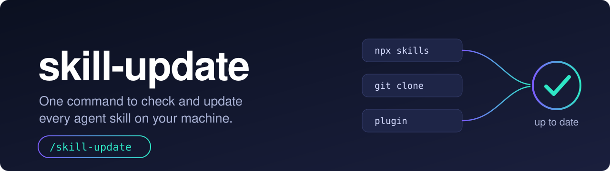
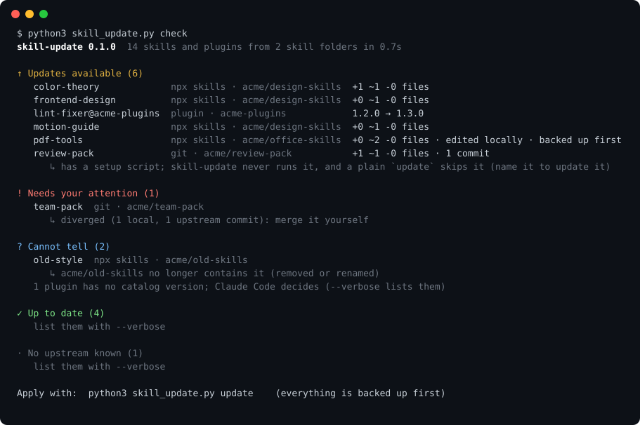
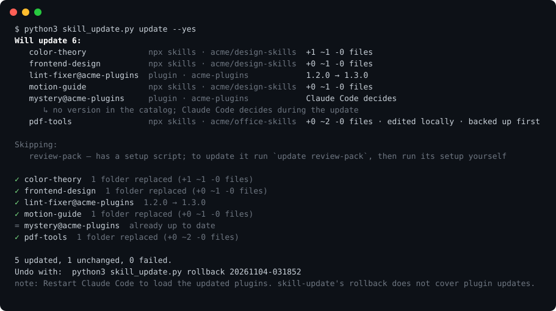

<p align="center">
  
</p>

# skill-update

One command to check and update every agent skill on your machine, however it got there.

[](https://github.com/kjhk3082/skill-update/actions/workflows/ci.yml) · [한국어](README.ko.md)

```bash
npx skills add kjhk3082/skill-update -g
```

Restart your agent, then run `/skill-update` (or just ask: *"are my skills up to date?"*).

Works with Claude Code, Codex, Cursor, Gemini CLI, OpenCode, GitHub Copilot, Windsurf, Kiro and every other agent that loads skills from a folder (more than 60 skill folders are known). Updating plugins needs Claude Code.

| Without skill-update | With skill-update |
|---|---|
| `npx skills check` only knows what `npx skills` installed.<br>Git clones: `cd` into each one and `git pull`.<br>Plugins: update them one by one.<br>Hand-copied skills: nothing tells you they are stale. | `/skill-update`<br>One scan of every skill folder, one report, one confirmation.<br>Every replaced folder is backed up first. |

<p align="center">
  
</p>

On the author's own machine, the first run found 32 outdated skills and plugins out of 216, and six skills whose source repository had stopped publishing them.

## Why

Skills reach your machine four different ways: `npx skills add`, a `git clone`, a Claude Code plugin, or a plain copy. Each has its own update story, or none. Skills rarely carry a version number, so they go stale without anyone noticing.

- **One report, every install channel.** skill-update reads the `npx skills` lock file, your git clones and the Claude Code plugin registry in one pass, across every agent's skill folder.
- **It compares files, not version strings.** Each installed folder is hashed exactly the way git hashes a tree and compared with the newest upstream folder. "Outdated" means the files really differ. It also notices skills you edited yourself, and skills whose upstream folder was renamed or removed.
- **Safe to run on a machine you care about.** Preview what changes, back up what gets replaced, verify the result against upstream, undo with one command. It never runs a script that an update brings along.

## How it works

1. **Find.** Scans the skill folders of every agent it knows (`~/.claude/skills`, `~/.agents/skills`, `~/.codex/skills`, `~/.cursor/skills`, and so on). Symlinks to one folder count once.
2. **Identify.** Each skill is matched to how it was installed: the `npx skills` lock file, a git clone, a Claude Code plugin, or neither.
3. **Compare.** The newest upstream is fetched with `git` (a partial clone, so only commit and tree data come down). The installed folder is compared with it file by file.
4. **Preview.** For each outdated skill you see how many files would be added, changed and removed, and whether you edited it.
5. **Update.** After you confirm: back up, replace, check that the new folder is identical to upstream, refresh the lock record so `npx skills check` agrees.

<p align="center">
  
</p>

### Commands

| Command | What it does |
|---|---|
| `check` | Lists what has a newer version. Changes nothing. This is the default. |
| `update [names]` | Updates what is outdated, after a preview and a backup. Pass names, or a source like `owner/repo`, to update only those. A git clone that ships a setup script is skipped unless you name it. |
| `rollback [run id]` | Restores what an update run replaced. `--list` shows the runs. |
| `scan` | Shows which skill folders were found. No network. |

Useful flags: `--json` (for agents and scripts), `--dry-run`, `--keep-modified` (leave skills you edited alone), `--only lock|git|plugin`, `--ignore NAME`, `--root DIR` (scan another skills folder), `--no-backup` (refused while a skill has local edits), `--refresh` (refresh plugin catalogs first), `-v`.

In an agent, the skill drives these for you and asks before changing anything. In a terminal:

```bash
python3 skills/skill-update/scripts/skill_update.py check
python3 skills/skill-update/scripts/skill_update.py update          # asks first
python3 skills/skill-update/scripts/skill_update.py update --yes    # unattended
```

## What it updates

| Installed by | Found through | Compared with | Updated by |
|---|---|---|---|
| `npx skills add` | `~/.agents/.skill-lock.json` | the same folder in the source repository | replacing the folder, then verifying it |
| `git clone` in a skills folder | a `.git` folder | the branch's upstream | `git merge --ff-only` (your uncommitted edits are stashed, never discarded) |
| Claude Code plugin | `~/.claude/plugins` | the marketplace catalog, when it publishes a version | `claude plugin update`, which decides for plugins without a version |
| anything else | | | reported as unmanaged, never touched |

## Safety

- **Backup first.** Replaced folders go to `~/.skill-update/backups/<run id>/`. The last 10 runs are kept. `rollback` puts them back, restores only the lock records the run changed, and stashes edits you made since.
- **Atomic.** Folders only move with `rename`, never copy-and-delete, so an interruption leaves the old folder or the new one. (Your skills and `~/.skill-update` must be on one disk; otherwise that skill is skipped with a hint.)
- **Verified.** After a replace, the new folder's hash must equal upstream's, otherwise the old one is restored automatically.
- **Only from the original source.** A skill is updated from the repository it was installed from, never from somewhere new.
- **No scripts.** `setup`, `install.sh` and friends are reported, never executed. A git clone that ships one is left out of a plain `update`, because its new files may need that script run again: name it (`update NAME`) to update it, then run the script yourself. Folders such as `node_modules` and virtualenvs inside a skill are carried over.
- **Your repositories are yours.** Git clones outside the skill folders, symlinks into other projects, and diverged clones are reported and left alone.
- **Hostile input is refused.** Source URLs, refs and folder names from lock files are validated before they reach `git`. Git clones whose own config could run a program (`core.fsmonitor`, `core.sshCommand`, filters, …) are left alone, hooks never run, and terminal control characters in names and messages are stripped before anything is printed.
- **No telemetry.** The only network traffic is `git` talking to the sources your skills came from (and `claude` for plugins). Private repositories use your own git credentials.

Local edits: a skill you edited by hand is replaced after a backup by default, and the preview says so. Use `--keep-modified` to protect edited skills.

## Installation

```bash
npx skills add kjhk3082/skill-update -g
```

Requires `git` 2.30+ and Python 3.9+. Node is only needed for `npx`.

<details>
<summary><b>Claude Code plugin</b></summary>

```
/plugin marketplace add kjhk3082/skill-update
/plugin install skill-update@skill-update
```

As a plugin, the skill is named `skill-update:skill-update`.

</details>

<details>
<summary><b>Manual copy, no Node required</b></summary>

```bash
git clone https://github.com/kjhk3082/skill-update.git
cp -R skill-update/skills/skill-update ~/.claude/skills/      # or ~/.agents/skills/ for Codex and others
```

</details>

<details>
<summary><b>Where it looks</b></summary>

`~/.claude/skills`, `~/.agents/skills` (Codex, Cline, Pi, Warp, Zed and others), `~/.codex/skills`, `~/.cursor/skills`, `~/.gemini/skills`, `~/.copilot/skills`, `~/.config/opencode/skills`, `~/.codeium/windsurf/skills`, `~/.kiro/skills`, `~/.hermes/skills`, `~/.config/goose/skills` and many more. Folders that do not exist are skipped. Run `scan` to see what it found on your machine. `CLAUDE_CONFIG_DIR`, `CODEX_HOME`, `HERMES_HOME` and `XDG_CONFIG_HOME` are honoured; add anything else with `--root`.

</details>

<details>
<summary><b>Configuration</b></summary>

Optional `~/.skill-update/config.json`:

```json
{ "ignore": ["my-private-skill"], "roots": ["/path/to/another/skills/folder"] }
```

Environment: `SKILL_UPDATE_HOME` (cache and backups, default `~/.skill-update`), `SKILL_UPDATE_LOCK` (lock file path), `SKILL_UPDATE_CLAUDE` (path to the `claude` command), `SKILL_UPDATE_DEBUG=1` (full traceback on an unexpected error), `NO_COLOR`.

</details>

## Good to know

- **Unmanaged skills** (copied by hand, or installed by a tool that keeps no record) cannot be updated automatically. If you know where one came from, `npx skills add owner/repo` brings it under management.
- **Folders the installer trims.** `npx skills add` leaves out `metadata.json` files, so a skill that has one still counts as current when it matches what the installer would have produced.
- **Rollback covers skills, not plugins.** Plugin updates are Claude Code's own; undo one with its commands.
- **Plugins** that their marketplace no longer lists are reported as needing attention (with the new name when it was renamed) rather than attempted. Plugin changes apply when Claude Code restarts. Plugins whose catalog publishes no version are handed to `claude plugin update`, which knows whether something newer exists.
- **Category folders** that hold skills one level deeper (as Hermes does) are not scanned yet.
- **Windows** is untested; use WSL.
- **Lock file**: only format version 3 is written. Another version is read but never modified.
- **Skill contents are not reviewed.** An update brings in whatever the upstream repository now contains. The preview tells you what changed; reading it is up to you.

## Development

```bash
python3 -m unittest discover -s tests -v     # sandboxed: every test uses its own HOME and local git repositories
python3 tools/make_demo.py                   # regenerate the screenshots in assets/
```

See [docs/DESIGN.md](docs/DESIGN.md) for how it works and [CONTRIBUTING.md](CONTRIBUTING.md) to help.

## License

[MIT](LICENSE)
